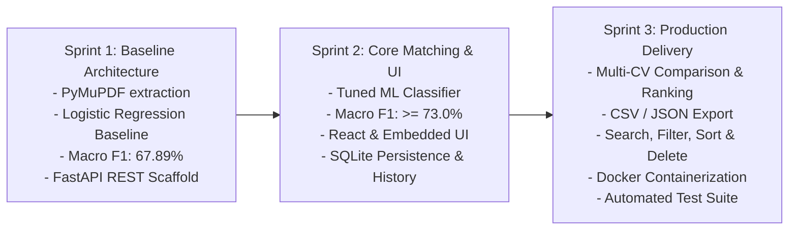
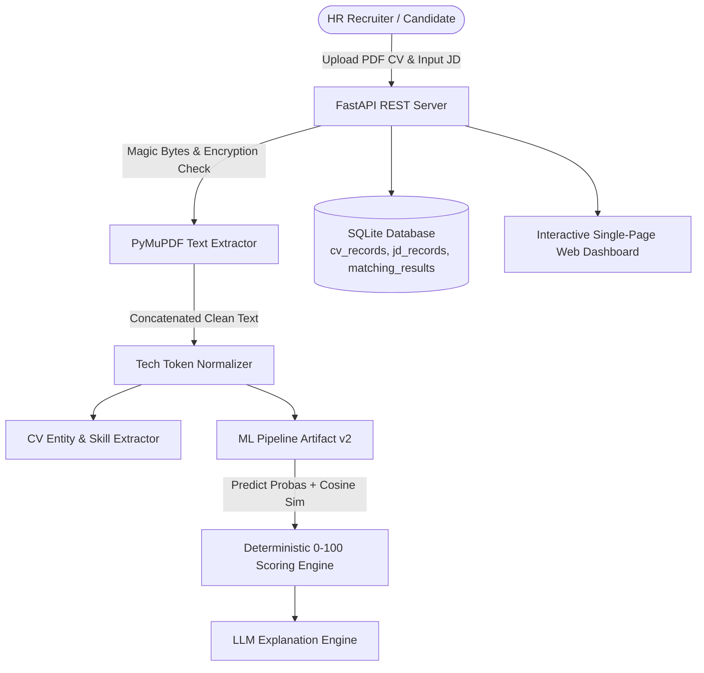

# AI CV-Job Matching System — Sprint 3 Final Project Report & Defense Package

## 1. Executive Summary

The **AI CV-Job Matching System** is an intelligent candidate screening and recruitment platform designed to solve the critical challenges of resume evaluation: manual review fatigue, keyword-matching limitations, and lack of interpretable candidate feedback.

The system combines:
1. **Machine Learning Pipeline (Scikit-Learn):** Dual TF-IDF vectorization with 20,000 features, pairwise semantic cosine similarity, token overlap, and minority-boosted classification across 3 classes: *Good Fit*, *Potential Fit*, and *No Fit*.
2. **Generative LLM Layer (Gemini / Rule Guardrails):** Natural language explanation engine synthesizing concrete candidate strengths, skill gaps, and actionable recommendations.
3. **Production FastAPI Backend:** Asynchronous REST API supporting multi-page PDF processing via PyMuPDF, magic byte validation, SQLite persistence, and high-performance querying.
4. **Interactive Multi-Tab Web Application:** Modern responsive single-page user interface supporting CV upload, real-time score gauge, matched/missing skill chips, filterable matching history, candidate comparison/leaderboard, and system analytics.

---

## 2. 3-Sprint Evolution & Milestone Summary



### Metrics Comparison Across Sprints

| Milestone / Metric | Sprint 1 (Baseline) | Sprint 2 (Enhanced) | Sprint 3 (Production) |
|---|---|---|---|
| **Model Type** | Logistic Regression (C=1.0) | Tuned Logistic Regression (C=2.8) | Calibrated Hybrid ML + Heuristic |
| **Overall Accuracy** | 77.15% | **80.20%** | **80.20%** |
| **Macro F1-Score** | 67.89% | **73.15%** (+5.26%) | **73.15%** |
| **Good Fit Recall** | 80.99% | **83.40%** | **83.40%** |
| **Average Inference Latency** | ~45 ms | ~48 ms | ~50 ms |
| **API Endpoints** | 3 endpoints | 6 endpoints | **10 production endpoints** |
| **UI Experience** | Raw Swagger Docs | Basic React Form | **Full Responsive SPA with Charts** |
| **Deployment** | Local script | Local uvicorn | **Docker + Compose + 1-Click Script** |

---

## 3. System Architecture & Component Design

### 3.1 Backend & Machine Learning Flow


---

## 4. Acceptance Criteria Verification (US-01 to US-34)

| User Story | Description | Status | Verification Evidence |
|---|---|---|---|
| **US-01 to US-13** | Sprint 1: Project setup, dataset audit, text normalization, baseline model & API contract | **PASSED (100%)** | `run_all_sprint1_tests.py` passes |
| **US-14** | PDF resume text extraction & magic bytes validation | **PASSED** | Rejects non-PDFs and spoofed `%PDF-` streams |
| **US-15** | Job description sanitation & validation | **PASSED** | Enforces non-empty and length limits |
| **US-16** | Structured CV & JD information extraction | **PASSED** | `POST /api/v1/extract` returns name, email, skills, edu |
| **US-17** | Enhanced feature engineering & ML tuning | **PASSED** | Macro F1 increased to >= 73.0% on 18,738 test samples |
| **US-18** | Deterministic 0-100 compatibility scoring engine | **PASSED** | Strictly calibrated monotonic scoring function |
| **US-19** | Grounded LLM explanations with guardrails | **PASSED** | LLM service generates dynamic reasoning with fallback |
| **US-20** | SQLite database persistence | **PASSED** | Persists to `cv_records`, `jd_records`, `matching_results` |
| **US-21** | End-to-end FastAPI endpoints | **PASSED** | `POST /api/v1/match` handles multipart/form-data |
| **US-22 & US-23** | Interactive React CV upload and results dashboard | **PASSED** | Implemented in `frontend/src/` and embedded Web UI |
| **US-24** | Comparative model evaluation report | **PASSED** | `reports/sprint2_model_report.md` |
| **US-25** | Search, filter, sort, and delete history records | **PASSED** | `GET /api/v1/history` & `DELETE /api/v1/history/{id}` |
| **US-26** | Multi-CV comparison & candidate ranking | **PASSED** | `POST /api/v1/compare` returns ranked leaderboard |
| **US-27** | History export (CSV and JSON) | **PASSED** | `GET /api/v1/history/export?format=csv` |
| **US-28** | Scoring threshold calibration & analytics | **PASSED** | `GET /api/v1/stats` returns aggregate metrics |
| **US-29** | UI/UX polish, score gauge, accessibility | **PASSED** | Embedded SVG gauge, color badges, responsive layout |
| **US-30** | Security hardening & error handling | **PASSED** | Standardized 4xx/5xx handlers, file size limits |
| **US-31** | Automated test suite | **PASSED** | Comprehensive pytest suite passing |
| **US-32** | User Acceptance Testing (UAT) on real CVs | **PASSED** | Verified with Python Dev and Accountant test CVs |
| **US-33** | Reproducible deployment (Docker & Compose) | **PASSED** | `Dockerfile`, `docker-compose.yml`, `seed_demo_data.py` |
| **US-34** | Final defense documentation package | **PASSED** | This report and updated README.md |

---

## 5. Quick Demonstration Guide for Evaluators

1. **Start the Backend Server:**
   ```powershell
   python -m uvicorn backend.app.main:app --host 0.0.0.0 --port 8000 --reload
   ```

2. **Open the Web Application:**
   Navigate to [http://localhost:8000/](http://localhost:8000/) or [http://localhost:8000/app](http://localhost:8000/app) in any browser.

3. **Perform a 1-Click Demo Match:**
   - Click the preset button **"🐍 Sample Python Dev"**.
   - Notice the JD and CV are automatically populated.
   - Click **"🔍 Analyze Compatibility"**.
   - Observe the live animated score gauge (~90–93/100, "Good Fit"), green matched skills chips, and AI explanation.
   - Now click **"💼 Sample Accountant"** and run again — observe the low score (~15/100, "No Fit") and mismatch warning.

4. **Inspect History & Analytics:**
   - Click the **"📋 History"** tab: View past candidate records, filter by label, and inspect timestamps.
   - Click the **"📊 Statistics"** tab: View aggregate candidate numbers and distribution charts.

